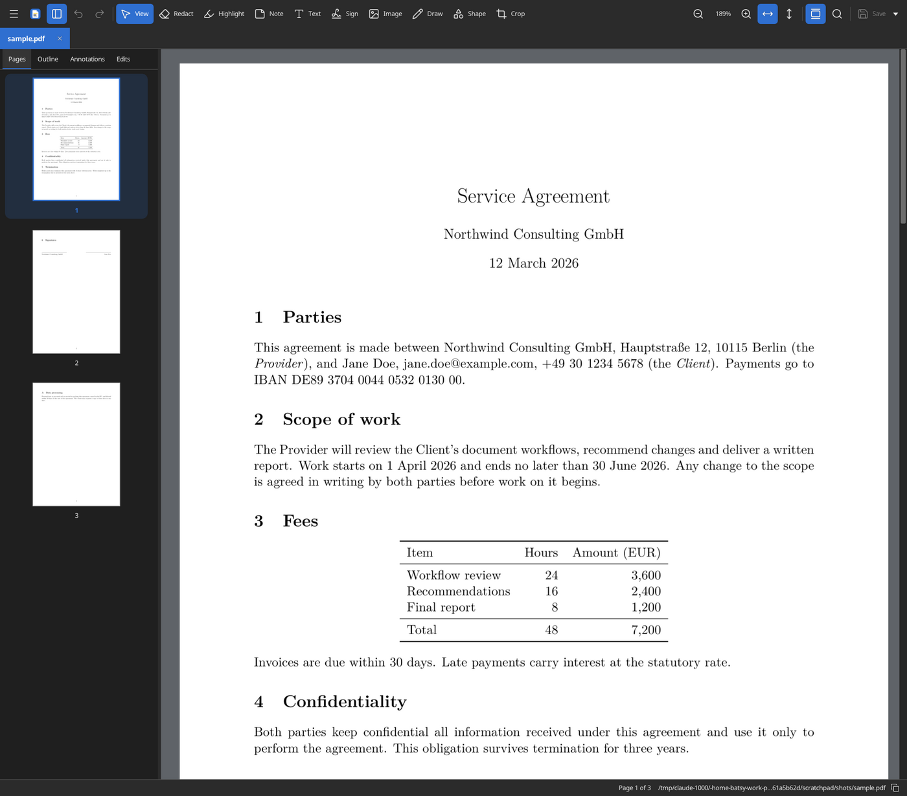

# PDF Tools

A PDF viewer and editor for Linux, macOS and Android, with a command line for scripts and agents.



## Features

- **Redact**: the text, images and drawings under each mark are removed, not covered. Find personal data
  (e-mails, phone numbers, IBANs, card numbers, dates, ID numbers) and mark it in one go. Saving also scrubs
  metadata, attachments, scripts, hidden text and thumbnails.
- **Edit**: highlight and other marks, notes, text, images, drawings, shapes, forms, crop, rotate, reorder,
  insert and remove pages, Bates numbers, watermarks, document properties, outline.
- **Sign**: a picture of your signature, or a digital certificate signature (.p12).
- **More**: OCR (Tesseract), compare two PDFs, combine and split, export pages as PDF or images, protect with a
  password, print. Undo and redo, find with regular expressions, two pages side by side, presentation mode (F5).
- **LaTeX**: open PDFs reload when they change on disk; SyncTeX jumps between the PDF and the source.

## Install

Each push builds a Linux AppImage, a macOS `.dmg` and an Android APK on GitHub Actions (artifacts
`PDF-Tools-Linux`, `PDF-Tools-macOS` and `PDF-Tools-Android`).

On Linux, make the AppImage executable and run `./PDF_Tools-x86_64.AppImage --install-desktop` once to add it to
the applications menu and to "Open with" for PDFs (`--uninstall-desktop` removes it; after moving the AppImage, run
it again).

On a Mac the app is not notarized: open it the first time with right-click > Open.

## Build

```sh
platform/linux/build.sh      # ~/.cache/pdf-tools/linux/out/PDF_Tools-<arch>.AppImage
platform/macos/build.sh      # ~/Library/Caches/pdf-tools/macos/out/PDF-Tools.dmg
platform/android/build.sh    # ~/.cache/pdf-tools-native/android/out/pdf-tools.apk (details: platform/android/README.md)
```

On Linux the script builds one `pdf-tools` binary (`~/.cache/pdf-tools/linux/build/pdf-tools`), with its
dependencies linked in except fontconfig, OpenGL and the window system's libraries, and packs it with the English
OCR data as the AppImage. To install the binary instead, with its man page, desktop entry, icon and OCR data:

```sh
platform/linux/build.sh install ~/.local
```

The scripts download and build the pinned dependencies ([MuPDF](https://mupdf.com) with
[Tesseract](https://github.com/tesseract-ocr/tesseract), [PCRE2](https://github.com/PCRE2Project/pcre2),
[OpenSSL](https://www.openssl.org), [raylib](https://www.raylib.com) and [raygui](https://github.com/raysan5/raygui))
and run the tests. On Debian/Ubuntu the Linux script needs `build-essential cmake pkg-config curl git libfontconfig-dev
libx11-dev libxrandr-dev libxinerama-dev libxcursor-dev libxi-dev libgl1-mesa-dev libegl-dev libxkbcommon-dev
libwayland-dev wayland-protocols`.

With your own dependencies (found through pkg-config: `mupdf` 1.28, `libpcre2-8`,
[`fontconfig`](https://www.freedesktop.org/wiki/Software/fontconfig/), `libcrypto`; raylib 6.2 through
`CMAKE_PREFIX_PATH`):

```sh
cmake -S . -B build -DCMAKE_PREFIX_PATH=/path/to/raylib && cmake --build build && ctest --test-dir build
cmake --install build --prefix ~/.local
```

Without raylib, `pdf-tools` is built with the commands only.

## Usage

```sh
pdf-tools file.pdf                          # open in the window
pdf-tools redact in.pdf -o out.pdf --text "Jane Doe" --regex 'DE\d{20}'
pdf-tools info in.pdf
pdf-tools COMMAND --help
pdf-tools --version
```

Commands print one JSON object and exit with a meaningful code; `AGENTS.md` documents them. Others: `search`,
`render`, `annotate`, `draw`, `insert-text`, `insert-image`, `sign`, `bates`, `watermark`, `ocr`, `compare`,
`export-images`, `scrub`, `inspect`.

- Settings: `~/.config/pdf-tools/settings.toml` (e.g. `editor_command = "code -g %f:%l"` for SyncTeX).
- OCR needs Tesseract's `LANG.traineddata` in `$TESSDATA_PREFIX`, `$XDG_DATA_HOME/pdf-tools/tessdata` or the
  system's data folders; the AppImage, the macOS app and the APK include English.
- LaTeX: compile with `-synctex=1`. Ctrl+click in the PDF opens the source line in your editor;
  `pdf-tools --forward file.pdf LINE file.tex` shows a source line in the PDF.
- Interface size: View > Appearance > Interface size, or Ctrl+Alt++ / Ctrl+Alt+- (Ctrl+Alt+0: automatic); saved as
  `ui_scale` in the settings.
- Logging: `PDF_TOOLS_LOG=error|warn|info|debug`.

## Safety

Check redacted files before sharing them. A picture signature is not a cryptographic one; use a certificate for
that. Passwords given on the command line can show in process listings.

**License:** AGPL-3.0-or-later, as [MuPDF](https://mupdf.com/licensing).
